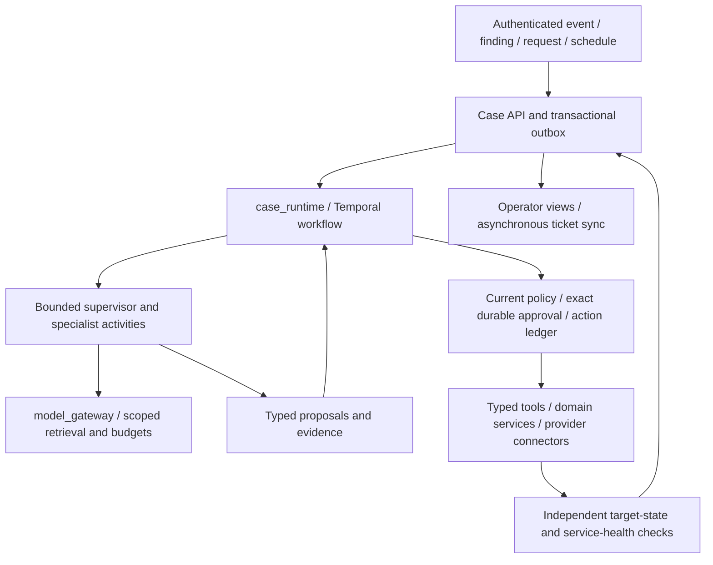

# Agentic platform target and ownership

Status: accepted architecture direction, October 16, 2026. Implementation pending.
The [source map](overview.md) describes current code; [release scope](../../RELEASE_SCOPE.md)
defines supported checks. This page does not expand the supported runtime surface.

## Selected boundaries

The [runtime decision](decisions/0001-case-runtime.md) selects one `case_runtime`
facade with Temporal as its durable workflow engine. PostgreSQL owns application
case, approval, evidence-reference and action records. Temporal owns execution
history and scheduling; database views of execution progress are projections.
Domain services enforce operations. AI roles propose work and interpret evidence.

The diagram shows the target. It is not a connectivity or deployment test.
Multiple cases run concurrently; each has one logical supervisor/plan owner.
Specialists request bounded work through the runtime. They do not start independent
case action loops. A common worker pool may host multiple roles without giving
those roles each other's capabilities.

## What source already provides

The public [runtime models](../../backend/libs/sg_agent_runtime/models.py),
[SOC contracts](../../backend/libs/sg_agent_runtime/soc_models.py),
[case client](../../backend/libs/sg_agent_runtime/soc_case_runtime_client.py),
[playbook IR](../../backend/libs/sg_agent_runtime/playbook_ir_models.py),
[response-pack matching](../../backend/libs/sg_agent_runtime/response_pack_matcher.py),
[compliance helpers](../../backend/libs/sg_agent_runtime/compliance_workflow.py)
and [cloud modules](../../backend/libs/sg_core/cloud/) are migration inputs.
Preserve their accepted behavior or explicitly replace it before deleting paths.
An existing field, declaration or feature flag is not a verified capability.

`soc_case_agent` has a special handler that runs
[deterministic case planning](../../backend/libs/sg_agent_runtime/soc_case_task_handler.py).
Its planner and [ticket scribe](../../backend/libs/sg_agent_runtime/ticket_scribe.py)
use deterministic matching/templates. They are not evidence of a model-directed
supervisor. Other declarations can use the [generic model loop](../../backend/libs/sg_agent_runtime/agent_loop.py),
subject to registered tools, flags and runtime availability. Preserve this
distinction in labels, documentation and telemetry.

Current task and case memory use Redis. They must not be relabeled as the selected
transactional case store. Existing [SOAR execution](../../backend/agents/soar_agent/app/services/playbook_execution_service.py),
[Celery helpers](../../backend/libs/sg_tasks/) and automatic response paths need
explicit adapters and cutover, rather than concurrent ownership of a new case.

## Responsibility and migration map

Source paths and deployment names stay compatible until a tested migration changes
them. Target names below are planned responsibilities, not renamed directories or
working services. Additional source detail lives in [component categories](../reference/agent-components.md).

| Current responsibility / source | Target owner | Migration rule |
| --- | --- | --- |
| `sg_agent_runtime` task API, loop, memory and case adapters | `case_runtime` plus bounded agent activities | Retain contracts through adapters; move execution ownership once; preserve response packs, playbook IR, feedback and compliance helpers |
| `soc_case_agent`, `SOCResponsePlanner`, `SOCTicketScribe` | Deterministic case-planning/documentation modules | Preserve useful baseline behavior; do not alias a heuristic handler into a newly enabled AI supervisor |
| IAM service under `backend/agents/iam_agent` | `identity_service` | Keep token validation, authorization, entitlement enforcement and identity operations deterministic; add reasoning through separate permitted roles |
| SIEM service under `backend/agents/siem_agent` | `siem_service` / `detection_service` | Keep search, ingestion and rule execution as services; bounded triage/investigation consumes their tools |
| SOAR APIs and playbook operations under `backend/agents/soar_agent` | `response_service` and `case_runtime` | Runtime schedules; response service performs an authorized operation and returns receipts; static and AI plans share the same action boundary |
| MCP server under `backend/agents/mcp_server` | `tool_gateway` | Expose typed operations; preserve wire names through explicit mappings; no independent orchestration or permission authority |
| `orchestrator` posture/approval responsibilities | `posture_service` for assessment APIs; `case_runtime` for case approvals | Split by responsibility; route old approval entrypoints through the same durable approval/policy boundary |
| `action_service`, `automated_response_service`, `sg_tasks` | Authorized response adapters and subordinate jobs | No competing action initiators; preserve legacy behavior until cutover, then drain/disable its ownership |
| `scanner_orchestrator`, Posture/Pentest analyzer jobs | `scan_runner` / `analyzer_runner` and domain APIs | Subordinate bounded jobs retain scope and authorization; a scanner is not an AI agent or a second case owner |
| `compliance_service`, `framework_service`, evidence/reporting modules | Deterministic compliance/framework/reporting services | A separate `compliance_evidence_agent` may propose work; do not duplicate service ownership under another agent container |
| `model_gateway` | `model_gateway` | Select models/retrieval by trusted tenant, task, capability, sensitivity, deployment policy and budget; keep facts/permissions in live systems |
| Ticketing, CMDB, metadata, observables and incident APIs | Their existing domain services | Resolve case context directly; ticket sync is asynchronous and is not an investigation prerequisite |
| Telemetry ingestion and email collection | Ingestion services and source-specific collectors | Preserve provenance; authenticate source and separate collection from reasoning |
| Cloud registry, adapters, change requests and remediation code | Cloud/posture domain modules and provider connectors | Preserve provider-agnostic contracts and concrete adapter behavior; new names do not establish additional working providers |
| SentinelGuard and vendor endpoint software | Sensor/endpoint management boundary | Retain product branding, installed IDs, enrollment identity and vendor names until explicit compatible migration |
| AI Shield | AI security gateway/service boundary | Keep its own contracts and policy controls; the model gateway and reasoning roles remain different responsibilities |

## Playbook content and adaptive plans

Use the existing Playbook library/editor as the procedure authority, extended with
immutable versions and fixed, conditional or adaptive planning contracts. WF-* IDs
are use-case coverage goals linked many-to-many to those versions, not a parallel
executable registry. A stable runtime protocol consumes bounded case-plan data;
models cannot deploy arbitrary generated code. Preserve keys, tenant overrides,
full definitions, plan revisions and execution history.

The [adaptive Playbook and evidence design](adaptive-playbooks.md) defines routing/
detection-quality gates, semantic graph compilation, controlled replanning and
run manifests/events/artifacts independent of engine recovery history. This
refinement retains Temporal behind `case_runtime`; framework replacement requires
a superseding ADR and evidence.

## Execution, authority and records

The [contracts](../reference/agentic-contracts.md) define the logical versioned
records and [the role catalog](../reference/agent-registry.md) defines proposed
canonical role names. A definition, deployment, installed sensor and execution are
different identities.

Authenticate intake and derive tenant UUID/caller context from verified identity.
Commit a case/run request before acknowledging acceptance. The runtime chooses
reachable work from a validated plan, enforces budgets/deadlines, and records
decisions and task progress. Independent evidence gathering may run in parallel.
Effects require current deterministic policy and exact approval or bounded
pre-authorized authority. Neither a supervisor nor an analyst-tier label can waive
that boundary.

The same gate covers UI/API requests, MCP, mapped playbooks, scheduled triggers and
model-selected tools. Provider credentials are resolved at execution and never
accepted from a model. Treat email, logs, retrieved text and tool output as untrusted
data. A missing tool, failed approval submission or simulated result cannot become
verified success.

Keep task success, action execution, action verification and case closure separate.
Verification re-queries authoritative state and service health; it may reject the
executor's conclusion. Human owners decide risk acceptance, legal obligations,
personnel matters and external communications. Closure records scope, observation
window, residual uncertainty and outstanding ownership rather than claiming all
adversary activity has ceased.

## One representative conditional workflow

For a privileged-sign-in signal, authenticate/deduplicate intake and create or
correlate a case. Triage determines evidence quality and plausible scope. Identity
investigation checks session and privilege evidence; endpoint, intelligence and
cloud work are added only when the evidence warrants them. Independent collection
can proceed in parallel.

The supervisor reconciles findings and proposes a plan. The response role compares
containment options with protected accounts and service dependencies. The runtime
binds exact actions to policy/approval and sends them through typed connectors.
Verification checks the actual session/access/host state and service health.
Recovery and owner acceptance precede evidence-based closure; tickets follow the
case outcome. Missing session/endpoint evidence produces a visible blocker or
scoped escalation. Repeated alerts and worker restart must not repeat effects.

The same architecture accepts exposure findings and scheduled access reviews;
they need not first become SIEM incidents. A schedule in a definition is a trigger
contract, not authorization to operate a customer's systems.

## Compatibility and delivery boundaries

- Naming rules in [AGENTS.md](../AGENTS.md) apply to new components. Inventory and
  translate existing identifiers; never rename services, routes, queues or sensor IDs
  merely by changing display labels.
- Alias mappings are versioned, scoped and tested. They cannot widen old permissions,
  combine the union of two roles' tools, or silently promote a deterministic helper
  to a reasoning role. Drain active runs against their original definitions.
- Transfer accepted source into the independent public history without importing
  private artifacts or competing historical design documents.
- Define physical storage and compatible upgrades in the database plan before
  implementation. Add application ORM and Flyway changes together; do not overwrite
  applied versions or create schema at startup.
- Introduce the selected runtime behind an unenabled execution path, prove replay,
  denial, recovery, approval and verification gates, then cut over one workflow/path
  at a time. Rollback stops/drains scheduling and reconciles receipts; it does not
  re-enable two owners or undo already observed external effects.

The runtime implementation, provider qualification and workflow enablement are
future work. This design does not change the immutable preview release or certify
the full platform.
