# Cloud-provider source architecture

Status: experimental review source, October 15, 2026. The owner selected this cloud
work for inclusion. V013 is pending source, not an applied database upgrade.
This page consolidates the earlier phase log into the implemented source boundaries
and the remaining design intent. No provider operation is supported by the preview.

## Source boundaries

| Layer | Entry point |
| --- | --- |
| Registry and aliases | [registry.py](../../backend/libs/sg_core/cloud/registry.py) and [example registry](../../backend/config/cloud_provider_registry.example.yaml) |
| Shared dataclasses and adapter protocol | [types.py](../../backend/libs/sg_core/cloud/types.py) |
| Adapter factory | [factory.py](../../backend/libs/sg_core/cloud/adapters/factory.py) |
| Concrete adapter | [hetzner.py](../../backend/libs/sg_core/cloud/adapters/hetzner.py) |
| Onboarding normalization | [onboarding.py](../../backend/libs/sg_core/cloud/onboarding.py) |
| Target context | [targets.py](../../backend/libs/sg_core/cloud/targets.py) |
| Control evaluation and planning | [controls.py](../../backend/libs/sg_core/cloud/controls.py), [remediation.py](../../backend/libs/sg_core/cloud/remediation.py) |
| Baseline persistence/state helpers | [baseline.py](../../backend/libs/sg_core/cloud/baseline.py), [baseline_state.py](../../backend/libs/sg_core/cloud/baseline_state.py) |
| Approval/apply mechanics | [change_requests.py](../../backend/libs/sg_core/cloud/change_requests.py) |
| HTTP/persistence/Vault boundary | [IAM onboarding routes](../../backend/agents/iam_agent/app/api/onboarding.py) |
| Public proxy and jobs | [gateway routes](../../backend/services/api_gateway/app/api/routes_onboarding.py), [job handlers](../../backend/libs/sg_core/jobs/handlers.py) |

The factory's built-in adapter maps name Hetzner aliases. A provider appearing in
the registry or UI does not prove that a matching adapter or workflow exists.
Provider/resource/account IDs are configuration data, not new product workflows.

## Flow represented in code

```mermaid
flowchart LR
    UI[Cloud onboarding UI] --> API[Generic onboarding routes]
    API --> Registry[Provider registry]
    Registry --> Adapter[Adapter factory / Hetzner]
    Adapter --> Resource[Normalized resources and firewall policy]
    Resource --> Control[Generic controls]
    Control --> Plan[Desired state / IaC metadata]
    Plan --> Request[Infrastructure change request]
    Request --> Approval[Authorization and scope checks]
    Approval --> Apply[Explicit experimental apply path]
```

The adapter protocol declares authentication validation, discovery, resource and
relationship reads, firewall normalization, planning, and apply methods. That
protocol is an interface, not proof that every method/provider is operational.
The shared planner emits desired state and IaC patch metadata. Executing a generated
IaC change, or allowing direct API mutation, remains a separate authorization and
runtime-safety problem.

The generic route family includes `connect-cloud`, provider metadata, and cloud
change-request approval/apply. Route code owns tenant-scoped persistence and Vault
access; the shared cloud layer handles normalized targets, plan regeneration,
scope hashes, and adapter dispatch. Review authorization, stale-state denial,
replay/concurrency behavior, and secret retrieval at both boundaries.

## Data and validation

[InfrastructureChangeRequest's ORM](../../backend/libs/sg_core/models.py) is paired
with [V013](../../backend/migrations_consolidated/V013__public_hetzner_infrastructure_change_requests.sql).
The [offline contract tests](../../backend/tests/test_infrastructure_change_schema.py)
compare schema, JSONB/defaults, and indexes without executing a migration.
[Task 5's review](../release/contents.md) records the cloud-focused tests that were
run. These do not establish a fresh database install, an upgrade, a restore, live
cloud isolation, or safe approval/apply execution.

Examples use synthetic resource IDs and documentation networks. Do not treat a
pilot name or registry entry as a real customer, supported provider, or permission
to connect an account. Richer target selection, additional adapters, live migration
qualification, and end-to-end provider tests remain future work. New schema changes
must follow [AGENTS.md](../AGENTS.md).
