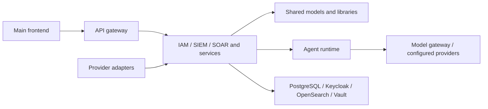

# Architecture and source map

Status: current source-reference map, reviewed October 15, 2026. Runtime execution
is experimental. [Release scope](../../RELEASE_SCOPE.md) defines the verified surface.
This map replaces the competing overall-design drafts and completion summaries.

## Boundaries visible in source

The diagram is a code-navigation map. It does not certify connectivity, deployment,
identity boundaries, or an end-to-end event-to-response workflow.

| Surface | Source entrypoint | Review boundary |
| --- | --- | --- |
| Main console and marketing prototypes | [frontend/src/app](../../frontend/src/app/) | Focused auth tests pass; full build/backend integration unqualified |
| Browser/API boundary | [API gateway](../../backend/services/api_gateway/app/) | Inspect each proxy's authentication and tenant forwarding |
| Identity | [IAM agent](../../backend/agents/iam_agent/app/) | Named mocked auth regressions; other admin and identity flows experimental |
| Detection and response | [SIEM](../../backend/agents/siem_agent/), [detection service](../../backend/services/detection_service/), [SOAR](../../backend/agents/soar_agent/) | Source exists; no two-tenant event-to-response E2E certification |
| Shared models and cloud code | [sg_core](../../backend/libs/sg_core/) | ORM/DDL contract checked offline; live migrations and provider operations excluded |
| AI task execution | [sg_agent_runtime](../../backend/libs/sg_agent_runtime/) | Source declarations and feature flags differ from enabled runtime capabilities |
| Model/embedding services | [Model gateway](../../backend/services/model_gateway/) | Runtime dependencies and provider calls unqualified |
| Endpoint collectors | [SentinelGuard](../../SentinelGuard/), [Wazuh references](../../agents/wazuh/) | Separate source/package concepts; installers and live enrollment excluded |
| Additional subsystems | [AI Shield](../../SentinelGridAIShield/), [Posture](../../SentinelGridPostureAgent/), [Pentest](../../SentinelGridPenTestAgent/) | Experimental component source; no active scanning or standalone-runtime clearance |
| Infrastructure | [infra](../../infra/), [charts](../../charts/), [terraform](../../terraform/), [packer](../../packer/) | Reference implementation; deployment and packaging workflows disabled |

## Selected target design

The [agentic platform target](agentic-platform.md) and
[runtime ADR](decisions/0001-case-runtime.md) record the accepted future ownership
and engine decision. They do not describe a deployed runtime. The
[logical contracts](../reference/agentic-contracts.md) and
[proposed role catalog](../reference/agent-registry.md) distinguish new definitions
from legacy IDs and deterministic helpers. Current source paths and supported
preview checks remain as described on this page.

## Contracts to inspect

- [Identity and tenant boundaries](../reference/identity.md): required UUID isolation versus verified auth behavior.
- [Entity/evidence references](../reference/entity-model.md): shared story helpers rather than a persisted global graph.
- [Agent categories](../reference/agent-components.md): service, runtime, and endpoint agents are different concepts.
- [Cloud-provider source](cloud-providers.md): generic registry/types plus the concrete Hetzner adapter.
- [Database changes](../development/database-changes.md): paired ORM/Flyway edits and globally unique versions.
- [Database compatibility plan](database-compatibility.md): preserved lineage, proposed case storage, tenant controls and qualification gates.
- [Frontend ownership](frontend.md): `frontend/` is canonical; other UI trees are legacy/experimental.

## Implemented, simulated, and excluded

A file or route in the map is implemented source, not an operational promise.
Preview auth tests use mocked identity/network dependencies; their results do not
establish live provider behavior. UI examples and historical fixture data are not
customer evidence. Agent declarations, provider registry entries, and planned
adapters are not counted as working integrations. Container startup, live scans,
cloud apply, model training, customer data handling, and production operation stay
outside the supported preview. [Current evidence](../release/review.md) records
exact tests and open gates; archived signoffs cannot change that boundary.
