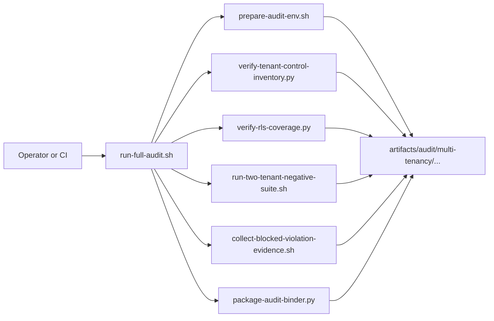

# Multi-Tenancy Audit Execution Spec

> **Historical reference — superseded for release decisions.** This records an earlier design, operation, or validation attempt. It is not the current architecture, a supported quick start, or evidence that the source preview is production ready. Start with the repository README and current documentation index.


**Status:** Draft  
**Date:** 2026-03-28  
**Audience:** Engineering, Security, Compliance, Platform  
**Related:** [MULTI_TENANCY_AUDIT_READINESS_PLAN.md](../README.md#retired-references)

Implementation sequencing and work items are tracked in [MULTI_TENANCY_AUDIT_IMPLEMENTATION_BACKLOG.md](multi-tenancy-audit-implementation-backlog.md).

Current remediation state and open backlog are tracked in [MULTI_TENANCY_REMEDIATION_STATUS.md](multi-tenancy-remediation-status.md).

## Purpose

This document turns the repeatability section of the multi-tenancy audit plan into a concrete implementation target.

The goal is to make SentinelGrid's tenant-isolation proof:

- repeatable
- script-driven
- environment-aware
- tied to a specific git revision
- packageable for auditors on demand

This spec is for the **audit execution pack**, not the application controls themselves.

## Outcome

When this spec is implemented, an authorized engineer should be able to run one command and produce a dated audit evidence package showing:

- the current tenant-isolation control inventory
- database RLS coverage and runtime context validation
- two-tenant negative test results
- blocked-violation evidence
- a signed manifest binding the evidence to:
  - git SHA
  - environment
  - execution timestamp
  - tenant pair used
  - command versions
  - pass/fail summary

## Non-Goals

This spec does not itself:

- change application behavior
- define every tenant-isolation test case in detail
- replace the broader readiness plan
- define auditor-facing policy language

## Deliverables

Implementation must produce all of the following:

1. script suite under `scripts/audit/multi-tenancy/`
2. execution runbook under `docs/archive/operations/multi-tenancy-audit-execution.md`
3. canonical artifact directory structure under `artifacts/audit/multi-tenancy/`
4. machine-readable manifest schema
5. CI workflow entry point for scheduled and on-demand execution
6. stable fixture strategy for the audit tenant pair

## System View



## Target Directory Layout

### Scripts

```text
scripts/audit/multi-tenancy/
  README.md
  run-full-audit.sh
  prepare-audit-env.sh
  run-two-tenant-negative-suite.sh
  collect-blocked-violation-evidence.sh
  verify-tenant-control-inventory.py
  verify-rls-coverage.py
  package-audit-binder.py
  lib/
    common.sh
    manifest.sh
    logging.sh
  config/
    audit-pack.env.example
    profiles/
      smoke.env
      standard.env
      full.env
  fixtures/
    tenant-pair.example.json
    expected-services.json
```

### Runbook

```text
docs/runbooks/
  multi_tenancy_audit_execution.md
```

### Artifacts

```text
artifacts/audit/multi-tenancy/<YYYY-MM-DD>/<run-id>/
  manifest.json
  environment.txt
  git-revision.txt
  commands.log
  summary.md
  control-matrix/
  rls-report/
  test-results/
  logs/
  exceptions/
  binder/
```

## Execution Profiles

The audit pack must support three execution profiles.

### `smoke`

Use case:
- developer validation
- fast CI sanity check

Must include:
- environment validation
- limited control inventory export
- minimal RLS report
- one narrow two-tenant negative test subset

Target duration:
- under 10 minutes

### `standard`

Use case:
- routine audit-readiness check
- weekly scheduled evidence run

Must include:
- full control inventory export
- full RLS coverage export
- P0 two-tenant negative suite
- blocked-violation evidence collection
- binder packaging

Target duration:
- under 45 minutes

### `full`

Use case:
- formal auditor demonstration
- pre-audit freeze evidence package

Must include:
- everything in `standard`
- broader multi-service negative matrix
- extra log collection
- additional integrity outputs and checksums

Target duration:
- under 90 minutes

## Canonical Command Interface

The main entry point must be:

```bash
scripts/audit/multi-tenancy/run-full-audit.sh --profile standard --env staging
```

### Required flags

- `--profile <smoke|standard|full>`
- `--env <local|staging|audit>`

### Optional flags

- `--run-id <id>`
- `--artifact-root <path>`
- `--tenant-pair-file <path>`
- `--skip-control-inventory`
- `--skip-rls`
- `--skip-tests`
- `--skip-log-collection`
- `--binder-only`
- `--keep-going`

### Exit codes

- `0`: all required steps passed
- `1`: command or prerequisite failure
- `2`: environment not ready
- `3`: control inventory mismatch
- `4`: RLS coverage failure
- `5`: negative suite failure
- `6`: evidence collection failure
- `7`: binder packaging failure

## Environment Contract

The audit pack must not depend on hidden shell state.

### Required environment variables

- `AUDIT_ENV_NAME`
- `AUDIT_PROFILE`
- `AUDIT_ARTIFACT_ROOT`
- `AUDIT_RUN_ID`
- `AUDIT_OPERATOR`
- `AUDIT_TENANT_A_ID`
- `AUDIT_TENANT_B_ID`
- `AUDIT_TENANT_A_REALM`
- `AUDIT_TENANT_B_REALM`
- `AUDIT_PLATFORM_ADMIN_REALM`

### Optional environment variables

- `COMPOSE_FILE`
- `API_GATEWAY_URL`
- `IAM_AGENT_URL`
- `KEYCLOAK_URL`
- `POSTGRES_URL`
- `AUDIT_LOG_SOURCE`
- `AUDIT_REDACTION_MODE`

### Environment file strategy

Profiles must load from:

```text
scripts/audit/multi-tenancy/config/profiles/<profile>.env
```

Environment-specific overrides may come from:

```text
scripts/audit/multi-tenancy/config/audit-pack.env
```

The committed repo should contain only:

- `audit-pack.env.example`
- profile defaults

It should not contain live secrets.

## Audit Tenant Pair Strategy

The audit pack must use a deterministic tenant pair, not arbitrary customer tenants.

### Required tenants

- `audit-tenant-a`
- `audit-tenant-b`
- optional platform admin actor for privileged or exception checks

### Requirements

- fixtures must be non-production and non-customer
- tenant slugs, IDs, and realms must be stable per environment
- the pack must verify the tenant pair exists before running tests
- the pack must fail if tenant fixtures are missing or ambiguous

### Fixture file

Canonical fixture definition:

```text
scripts/audit/multi-tenancy/fixtures/tenant-pair.example.json
```

Expected contents:

- tenant A ID
- tenant B ID
- tenant A slug
- tenant B slug
- tenant A realm
- tenant B realm
- sample seeded resources used for negative tests

## Script Specifications

## 1. `prepare-audit-env.sh`

### Purpose

Validate that the target environment is healthy and suitable for evidence generation.

### Inputs

- profile
- environment
- tenant pair file

### Required checks

- required binaries exist
- required services are reachable
- target git revision is recorded
- audit artifact root can be created
- audit tenant pair exists
- tokens or credentials can be issued
- expected services match profile requirements

### Outputs

- `environment.txt`
- `git-revision.txt`
- `commands.log` entry
- `preflight.json`

### Failure conditions

- service unreachable
- missing tenant fixture
- missing credentials
- unresolved environment mismatch

## 2. `verify-tenant-control-inventory.py`

### Purpose

Generate the current control inventory from code, docs, and approved registers.

### Inputs

- repo root
- exception register path
- route inventory config

### Required outputs

- `control-matrix/control-matrix.json`
- `control-matrix/control-matrix.csv`
- `control-matrix/public-routes.json`
- `control-matrix/internal-routes.json`
- `exceptions/shared-data-register.json`
- `exceptions/approved-exceptions.json`

### Minimum checks

- identify public vs internal routes
- identify tenant source used by each route
- identify override inputs
- identify services still trusting raw tenant headers
- identify known `tenant_id IS NULL` paths

### Implementation guidance

- Python is preferred here because the output is structured
- source annotations should be included for traceability

## 3. `verify-rls-coverage.py`

### Purpose

Verify that RLS exists where expected and capture runtime-use evidence.

### Inputs

- database connection string
- expected table registry
- optional schema filter

### Required outputs

- `rls-report/rls-tables.json`
- `rls-report/rls-policies.json`
- `rls-report/rls-summary.md`
- `rls-report/runtime-session-usage.json`

### Required checks

- enumerate tables with `tenant_id`
- enumerate tables with RLS enabled
- enumerate policies per table
- detect `FORCE ROW LEVEL SECURITY`
- identify runtime code using tenant-scoped DB sessions
- identify runtime code still using plain DB sessions for tenant-scoped paths

### Required decision rule

The script must distinguish:

- `expected and protected`
- `expected but not protected`
- `protected in schema but not clearly used at runtime`
- `intentionally exempt`

## 4. `run-two-tenant-negative-suite.sh`

### Purpose

Run the evidence-grade negative test matrix where tenant B attempts to access tenant A resources.

### Inputs

- tenant pair fixture
- profile
- environment URLs

### Required outputs

- `test-results/junit.xml`
- `test-results/summary.json`
- `test-results/scenario-matrix.csv`
- `test-results/raw/`

### Required scenario classes

- list access denied or bounded to own tenant
- direct ID lookup denied or bounded 404
- search/export cannot surface foreign rows
- onboarding/status cannot be overridden by foreign tenant input
- shared/global rows only appear where explicitly allowed

### Execution guidance

- orchestration can be shell
- actual test runner may call `pytest`, `jest`, or dedicated probes
- scenario matrix must be stable and versioned

## 5. `collect-blocked-violation-evidence.sh`

### Purpose

Collect evidentiary logs showing blocked tenant-isolation violations.

### Inputs

- artifact root
- log source configuration
- time window

### Required outputs

- `logs/blocked-violations.log`
- `logs/blocked-violations.json`
- `logs/log-collection-summary.md`

### Required behavior

- collect only the run-relevant time window
- redact secrets and raw tokens
- preserve actor, route, service, tenant, and response code context

## 6. `package-audit-binder.py`

### Purpose

Assemble the final evidence package and write the manifest.

### Required outputs

- `manifest.json`
- `summary.md`
- `binder/`
- optional `binder.zip`

### Required manifest fields

- `schema_version`
- `run_id`
- `timestamp_utc`
- `git_sha`
- `git_branch_or_tag`
- `environment`
- `profile`
- `operator`
- `tenant_pair`
- `command_sequence`
- `step_results`
- `artifact_checksums`
- `overall_status`

## 7. `run-full-audit.sh`

### Purpose

Orchestrate the full audit execution pack.

### Required step order

1. load profile and env
2. create artifact directory
3. run `prepare-audit-env.sh`
4. run `verify-tenant-control-inventory.py`
5. run `verify-rls-coverage.py`
6. run `run-two-tenant-negative-suite.sh`
7. run `collect-blocked-violation-evidence.sh`
8. run `package-audit-binder.py`
9. print final artifact path and summary

### Required runtime behavior

- every step appends to `commands.log`
- every step writes a machine-readable status file
- orchestrator stops on failure unless `--keep-going` is set

## Artifact Contract

Every run must be self-describing.

### Required root-level files

- `manifest.json`
- `summary.md`
- `environment.txt`
- `git-revision.txt`
- `commands.log`

### Required subdirectories

- `control-matrix/`
- `rls-report/`
- `test-results/`
- `logs/`
- `exceptions/`
- `binder/`

### Summary format

`summary.md` must include:

- execution overview
- environment
- git SHA
- tenant pair
- total checks
- failed checks
- open exceptions
- artifact locations

## Manifest Schema

Preferred format: JSON.

### Example

```json
{
  "schema_version": "1.0",
  "run_id": "2026-03-28-staging-standard-001",
  "timestamp_utc": "2026-03-28T14:05:22Z",
  "git_sha": "abc123def456",
  "environment": "staging",
  "profile": "standard",
  "operator": "ci:nightly-audit",
  "tenant_pair": {
    "tenant_a_id": "uuid-a",
    "tenant_b_id": "uuid-b",
    "tenant_a_realm": "sg-mt-us-1",
    "tenant_b_realm": "sg-mt-us-1"
  },
  "step_results": {
    "prepare_audit_env": "passed",
    "verify_tenant_control_inventory": "passed",
    "verify_rls_coverage": "warning",
    "run_two_tenant_negative_suite": "passed",
    "collect_blocked_violation_evidence": "passed",
    "package_audit_binder": "passed"
  },
  "overall_status": "warning"
}
```

## Runbook Specification

The runbook at `docs/archive/operations/multi-tenancy-audit-execution.md` must include:

1. purpose and audience
2. prerequisites
3. environment selection rules
4. tenant pair fixture selection
5. step-by-step command examples
6. expected runtime and artifact output
7. how to read the manifest
8. how to interpret warnings vs failures
9. how to hand the final binder to compliance or auditors
10. troubleshooting section

## CI Integration Specification

The execution pack must support:

- nightly scheduled run in a stable non-production environment
- manual workflow dispatch for audit demonstrations
- artifact upload and retention policy

### Required CI outputs

- stored `manifest.json`
- stored `summary.md`
- stored test reports
- downloadable binder package

### Retention targets

- nightly runs: 30 days minimum
- formal audit runs: 1 year minimum or per compliance retention policy

## Ownership Model

### Platform Engineering

- script orchestration
- artifact storage
- CI integration

### Security Engineering

- scenario matrix approval
- violation log requirements
- exception register review

### Compliance

- binder contents approval
- runbook review
- retention and handoff policy

### Service Owners

- route inventory accuracy
- exception justification
- data classification for shared/global records

## Implementation Sequence

### Step 1

Create structure only:

- `scripts/audit/multi-tenancy/`
- `docs/archive/operations/multi-tenancy-audit-execution.md`
- `artifacts/audit/.gitkeep` or equivalent ignore strategy

### Step 2

Implement foundation:

- `run-full-audit.sh`
- `prepare-audit-env.sh`
- `package-audit-binder.py`
- manifest schema

### Step 3

Implement evidence generators:

- `verify-tenant-control-inventory.py`
- `verify-rls-coverage.py`

### Step 4

Implement negative suite runner:

- `run-two-tenant-negative-suite.sh`
- scenario matrix and fixture files

### Step 5

Implement log evidence collection:

- `collect-blocked-violation-evidence.sh`

### Step 6

Wire CI and publish the runbook.

## Definition Of Done

This spec is implemented only when:

- a single command can generate the full evidence bundle
- the evidence bundle is tied to git SHA and environment
- the runbook is sufficient for a new engineer to execute the pack
- outputs are structured, stable, and retained
- the package can be handed to an auditor without manual reconstruction
